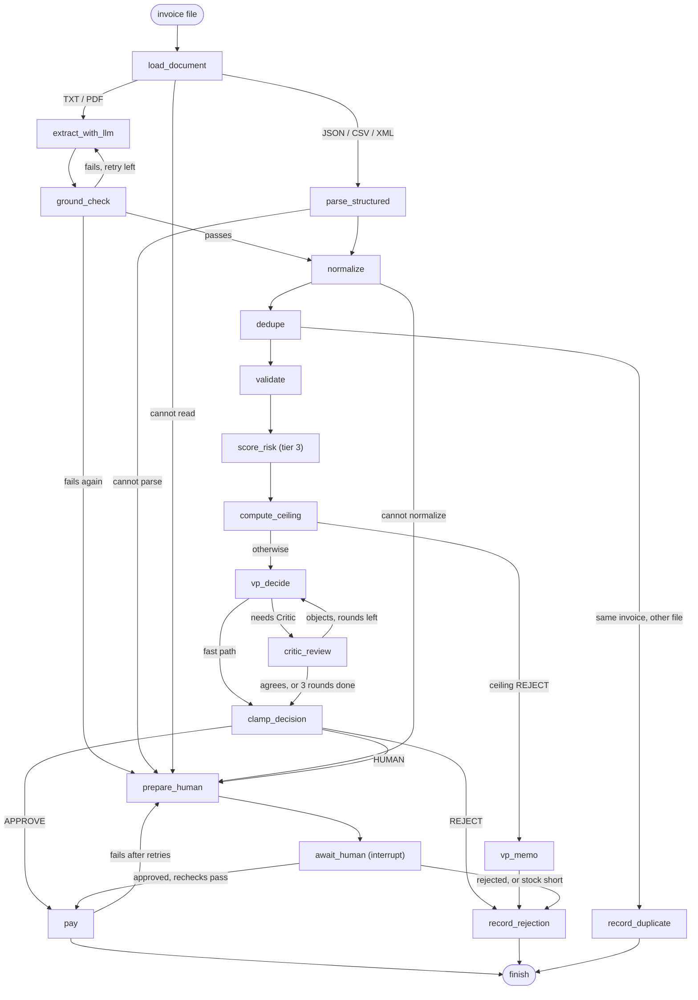
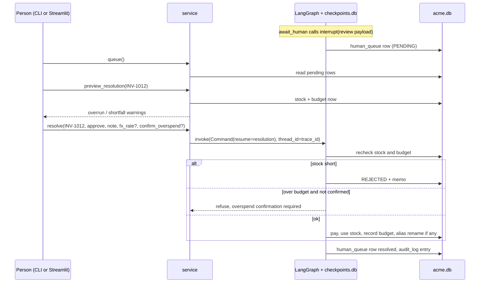

# Architecture

This file shows how the system is put together. For what it does and why, see [DESIGN.md](DESIGN.md). Section references like "§5" point there.

---

## 1. Layers

```mermaid
flowchart LR
    subgraph Interfaces
        cli["main.py (CLI, Rich)"]
        ui["ui/ (Streamlit)"]
    end
    svc["service.py<br/>run_invoice · run_batch · queue · resolve · reset"]
    graph["graph.py<br/>LangGraph state machine"]
    agents["agents/<br/>ingestion · validation · vp · critic · payment"]
    tools["tools/<br/>parsers · inventory · vendors · ledger · evidence · policy"]
    llm["llm/<br/>grok · ollama · replay · recorder · fake"]
    db[("acme.db")]
    ckpt[("checkpoints.db")]
    logs[["logs/*.jsonl"]]

    cli --> svc
    ui --> svc
    svc --> graph
    graph --> agents
    agents --> tools
    agents --> llm
    tools --> db
    graph --> ckpt
    svc --> logs
```

| Layer | Rule |
|---|---|
| **Interfaces** | Thin wrappers. CLI and Streamlit call the same `service` functions, so tier 1 never depends on tier 2. |
| **Service** | Owns run lifecycle: trace IDs, the exact-bytes short-circuit, batch ordering, provider selection, banner data, crash containment. |
| **Graph** | Routing only. Each node delegates to an agent function. |
| **Agents** | One module per stage. Pure functions `(state, deps) -> state update`. |
| **Tools** | Deterministic Python over repositories. Shared by agents and exposed to the LLM as tool schemas. |
| **LLM** | One `Provider` interface; agents never import a vendor SDK directly. |
| **Storage** | `acme.db` holds business data and the audit trail. `checkpoints.db` holds LangGraph pause/resume state. |

---

## 2. The graph

The exact-bytes check (DESIGN §7, first row) happens in `service.run_invoice` **before** a graph starts, so re-runs return the stored result without a new thread.



### Nodes

| Node | Stage | Does | LLM? |
|---|---|---|---|
| `load_document` | Ingestion | Detects format, reads bytes, extracts PDF text (pdfplumber), sets `file_hash` | — |
| `parse_structured` | Ingestion | JSON, field/value CSV, tabular CSV, XML → `ExtractedInvoice` | — |
| `extract_with_llm` | Ingestion | Structured-output call → `ExtractedInvoice` + `corrections` | ✓ |
| `ground_check` | Ingestion | Every extracted name/quantity/amount must appear in the source; on failure feeds the error back once | — |
| `normalize` | Ingestion | Invoice number, ISO dates, `Decimal` money, item and vendor name clean-up, `value_normalized` flags | — |
| `dedupe` | Validation | Fingerprint lookup → duplicate / conflict / revision handling | — |
| `validate` | Validation | All rule flags in DESIGN §3.3 against current stock, vendors, catalog, budget, as-of; address check against the vendor master (DESIGN §4.2) | — |
| `score_risk` | Validation | Additive risk score; `high_risk_score`, `prompt_injection` (tier 3; pass-through in tier 1) | — |
| `compute_ceiling` | Validation | Severity → ceiling; sets `needs_critic` | — |
| `vp_memo` | Approval | Rejection memo for ceiling REJECT | ✓ |
| `vp_decide` | Approval | Draft or revise decision; tool-calling loop | ✓ |
| `critic_review` | Approval | Review with shared + Critic-only tools; returns verdict and objections to the VP | ✓ |
| `clamp_decision` | Approval | `min(decision, ceiling)`, $10K Critic-agreement rule, deadlock → stricter, payment amount | — |
| `prepare_human` | Human | Builds the review (reasons, VP recommendation, amount) and writes the `human_queue` row. Separate from `await_human` because LangGraph re-runs an interrupted node from its first line on resume. | — |
| `await_human` | Human | `interrupt()` with the review payload; on resume, rechecks stock and budget | — |
| `pay` | Payment | Idempotent wrapped `mock_payment`, retries, uses stock and budget | — |
| `record_rejection` / `record_duplicate` | Terminal | Persist outcome + audit entries | — |
| `finish` | Terminal | Final status, timings, usage totals | — |

### Routing functions

```python
def route_after_ceiling(s):   return "vp_memo" if s.ceiling == REJECT else "vp_decide"
def route_after_vp(s):        return "critic_review" if s.needs_critic else "clamp_decision"
def route_after_critic(s):    return "vp_decide" if s.critic.verdict == OBJECT and s.round < MAX_ROUNDS else "clamp_decision"
def route_after_clamp(s):     return {APPROVE: "pay", REJECT: "record_rejection", HUMAN: "prepare_human"}[s.decision.final]

# needs_critic = ceiling == HUMAN or any escalation flag or amount_usd is None or amount_usd >= 9_000
#   (>= 9_000 covers both "over $10K" and the $9K–$10K split-invoice band, DESIGN §5)
```

---

## 3. State

One Pydantic model is passed through the graph and checkpointed at every step.

```python
class InvoiceState(BaseModel):
    # identity
    trace_id: str
    file_path: str
    file_hash: str
    format: Literal["json", "csv", "xml", "txt", "pdf"]

    # ingestion
    raw_text: str | None              # unstructured only; NEVER sent to the VP
    extracted: ExtractedInvoice | None
    corrections: list[Correction] = []
    extraction_attempts: int = 0
    invoice: Invoice | None           # normalized, Decimal money

    # validation
    fingerprint: str | None
    duplicate_of: str | None
    flags: list[Flag] = []            # code, severity, message, evidence
    risk: RiskScore | None            # score + contributing signals
    amount_usd: Decimal | None        # None for foreign currency until a person sets the rate
    address_check: Literal["verified", "mismatch", "not_on_invoice", "no_record"] | None
    ceiling: Ceiling | None           # REJECT < HUMAN < APPROVE
    needs_critic: bool = False

    # approval
    transcript: list[AgentTurn] = []  # VP and Critic turns, including tool calls and results
    round: int = 0
    decision: Decision | None         # proposed, final, by, reasoning, payment_amount

    # human + payment
    human: HumanReview | None         # reason, recommendation, resolution, note, fx_rate, overspend_confirmed
    payment: Receipt | None

    # outcome
    status: Status                    # PROCESSING | PAID | REJECTED | PENDING_HUMAN | DUPLICATE | CREDIT_DUE | SUPERSEDED | ERROR
    usage: Usage                      # tokens, cost, per-node durations
```

This is a sketch; `models.py` is authoritative and adds bookkeeping fields (`invoice_id`, `vendor`, `totals`, `payable_amount`, `llm_calls`, …).

`ExtractedInvoice` is the common shape every parser and the LLM produce. It contains `invoice_number, revision, vendor{name, address}, date, due_date, currency, line_items[{item, quantity, unit_price, amount, note}], subtotal, tax_rate, tax_amount, shipping, total, payment_terms, notes`, all as raw strings or numbers. `normalize` turns it into the typed `Invoice`.

---

## 4. Data model (`acme.db`)

| Table | Key columns | Notes |
|---|---|---|
| `inventory` | `item` PK, `stock`, `unit_price`, `category` | Seeded by `db/seed.py --seed demo\|readme` |
| `stock_ledger` | `id`, `item`, `delta`, `invoice_id`, `ts` | Every stock change; Ledger page reads this |
| `vendors` | `id`, `name`, `normalized_name`, `status`, `address`, `payment_terms` | Vendor master |
| `vendor_aliases` | `vendor_id`, `alias`, `kind` (`previous_name` \| `approved_rename`) | FastShip ↔ QuickShip after a person approves |
| `invoices` | `id`, `trace_id`, `file_path`, `file_hash`, `fingerprint`, `vendor_id`, `invoice_number`, `revision`, `status`, `ceiling`, `amount`, `currency`, `amount_usd`, `result_json`, `created_at` | `result_json` is what the exact-bytes short-circuit returns |
| `payments` | `idempotency_key` UNIQUE, `invoice_id`, `amount`, `currency`, `fx_rate`, `status`, `attempts`, `receipt_json` | Key = vendor + number + revision |
| `budget_ledger` | `id`, `month`, `amount_usd`, `invoice_id`, `ts` | Remaining = `monthly_budget_usd − SUM(amount_usd)` for the month |
| `human_queue` | `invoice_id`, `trace_id`, `reason`, `recommendation_json`, `status`, `resolution`, `note`, `resolved_at` | Mirrors pending interrupts for fast listing |
| `audit_log` | `id`, `trace_id`, `ts`, `actor` (`system`\|`vp`\|`critic`\|`human`), `event`, `payload_json` | Business audit trail (decisions, clamps, overrides) |

`checkpoints.db` is managed entirely by LangGraph's `SqliteSaver`. Thread ID = `trace_id`.

`--reset` drops and reseeds `acme.db`, deletes `checkpoints.db`, and keeps the logs.

---

## 5. Model layer (`llm/`)

```python
class Provider(Protocol):
    name: str
    def complete(self, *, stage: str, system: str, messages: list[Message],
                 schema: type[BaseModel] | None = None,
                 tools: list[ToolSpec] | None = None) -> Completion: ...
    # Completion = parsed output | tool calls, plus usage (tokens in/out, latency)
```

| Implementation | Purpose |
|---|---|
| `OpenAICompatProvider` | Grok (`https://api.x.ai/v1`) and Ollama (`http://localhost:11434/v1`) through one client (DESIGN §11) |
| `RecordingProvider` | Wraps a live provider and writes each call to `fixtures/replay/` (used by `scripts/record.py`) |
| `ReplayProvider` | Serves recorded completions keyed by `(file_hash, stage, prompt_version, call_index)`; raises `StaleRecording` on a miss |
| `ScriptedFake` | Tests only: returns pre-set decisions (the golden † rows) and canned extractions |

**Selection** (`llm/select.py`): an explicit `--provider` → `XAI_API_KEY` present → replay recordings exist for every file in the run → otherwise exit with a message. (Ollama joins in tier 3.)

**Prompts** live in `llm/prompts/*.md`, each with a `prompt_version` header. The version goes into the replay key, so editing a prompt invalidates its recordings.

**Tool-calling loop** (`agents/_loop.py`), shared by the VP and the Critic:
1. Call the provider with tools.
2. Execute the tool calls it returns.
3. Append the results and call again.

The loop stops after `max_tool_calls_per_turn` (6), at which point it demands the final structured output. Every call and result goes into `state.transcript` and the JSONL log.

---

## 6. Tools (`tools/`)

Every tool is a plain typed Python function over a repository. A decorator turns its signature into a JSON-schema `ToolSpec`.

| Tool | Module | VP | Critic |
|---|---|---|---|
| `get_vendor_history(vendor)` | `vendors.py` | ✓ | ✓ |
| `get_stock_level(item)` | `inventory.py` | ✓ | ✓ |
| `get_budget_status()` | `ledger.py` | ✓ | ✓ |
| `get_policy(topic)` | `policy.py` (reads `policy.md`) | ✓ | ✓ |
| `get_source_evidence(field)` | `evidence.py` (spans recorded by `ground_check`) | | ✓ |
| `recompute_totals()` | `evidence.py` | | ✓ |
| `find_similar_invoices(vendor, amount, days)` | `vendors.py` | | ✓ |
| `get_vendor_master(vendor)` | `vendors.py` | | ✓ |
| `get_pipeline_trace()` | `evidence.py` (reads `audit_log` for this trace) | | ✓ |

Tools that need the current invoice (`get_source_evidence`, `recompute_totals`, `get_pipeline_trace`) are bound to the state at call time. The LLM never passes a trace ID.

Parsers (`tools/parsers/`: `json_.py`, `csv_kv.py`, `csv_table.py`, `xml_.py`, `pdf.py`) are called by ingestion code directly and are not exposed to the LLM.

---

## 7. Pause and resume



`preview_resolution` lets both interfaces show the overspend amount *before* the person commits. The CLI enforces it with `--confirm-overspend`, and Streamlit with a checkbox.

---

## 8. Payment

```python
def pay(invoice, amount, currency, fx_rate=None) -> Receipt:
    key = f"{vendor_id}:{invoice_number}:{revision or 'R0'}"
    if existing := payments.get(key):          # idempotent
        return existing.receipt
    for attempt in range(1, retries + 2):         # first attempt + 3 retries
        try:
            maybe_inject_failure(fail_rate)        # --payment-fail-rate
            result = mock_payment(vendor_name, amount)   # README function, unchanged
            ...record payment, stock_ledger, budget_ledger in one transaction...
            return receipt
        except PaymentError:
            sleep(backoff * 2 ** (attempt - 1))
    raise PaymentFailed                           # graph routes to await_human (payment_failed)
```

The payment, its stock decrements and its budget entry are written in **one SQLite transaction**, so a crash can't leave stock used up without a payment.

---

## 9. Observability

**JSONL event** (`logs/YYYY-MM-DD.jsonl`):

```json
{"ts": "...", "trace_id": "inv-1007-3f9a", "invoice": "INV-1007", "node": "critic_review",
 "event": "tool_call", "duration_ms": 412, "tokens_in": 1830, "tokens_out": 212,
 "cost_usd": 0.0041, "provider": "replay", "data": {"tool": "recompute_totals", "result": {...}}}
```

- **Events:** `node_start`, `node_end`, `llm_call`, `tool_call`, `flag_raised`, `ceiling_clamped`, `retry`, `interrupt`, `resume`, `payment`, `error`.
- **Live display:** the Rich progress view and the Streamlit "Process" page both subscribe to graph stream events (`graph.stream(..., stream_mode="updates")`). The stage animation is the real event stream, not a separate simulation.

---

## 10. Error handling

| Failure | Handling |
|---|---|
| File can't be parsed / extraction fails grounding twice | `unreadable_document` → human (business path) |
| LLM returns invalid structured output | Provider retries once with the validation error; then the node raises |
| Any unhandled exception in a node | `service` catches it, marks the invoice `ERROR`, logs the traceback with `trace_id`, pays nothing, continues the batch |
| `StaleRecording` in replay | Same as above, with a "re-record" hint |
| Payment failure | Retries, then `payment_failed` → human |

---

## 11. Directory layout

```
main.py                 CLI entry (argparse; keeps README's --invoice_path form)
service.py              run_invoice, run_batch, queue, preview_resolution, resolve, reset
graph.py                LangGraph builder, routing functions
models.py               Pydantic models: InvoiceState, ExtractedInvoice, Invoice, Flag, Decision, ...
policy.md               Human-readable policy served by get_policy (thresholds, human reasons)
config/settings.toml    Thresholds, weights, budget, as-of, business assumptions
deps.py obs.py          Dependency bundle passed to nodes; JSONL event logger
core/                   text.py values.py invoice_math.py (shared name/value/totals helpers)
agents/                 ingestion.py validation.py risk.py vp.py critic.py clamp.py human.py payment.py outcome.py _loop.py
tools/                  registry.py toolsets.py inventory.py vendors.py ledger.py evidence.py policy.py normalize.py grounding.py bank.py
tools/parsers/          json_.py csv_kv.py csv_table.py xml_.py pdf.py
llm/                    base.py openai_compat.py recorder.py replay.py fake.py fake_golden.py select.py
llm/prompts/            extraction.md vp.md critic.md vp_memo.md
db/                     schema.sql seed.py repo.py
ui/                     app.py pages/1_Process.py 2_Human_queue.py 3_Ledger.py 4_Batch.py
scripts/                record.py
fixtures/replay/        recorded model calls (committed)
data/invoices/          provided samples (unchanged)
data/invoices_extra/    INV-2001..2006
tests/unit/ tests/golden/ tests/live/
logs/                   JSONL (git-ignored)
```

Tooling: `uv`, Python 3.12, `pyproject.toml`. Run with `uv sync`, `uv run python main.py ...` and `uv run streamlit run ui/app.py`.

---

## 12. Testing architecture

| Suite | Provider | Notes |
|---|---|---|
| `tests/unit/` | none / `ScriptedFake` | Parsers, normalization, each flag rule, ceiling, clamp, routing functions, payment idempotency, dedupe cases, tools |
| `tests/golden/test_sample_batch.py` | `ScriptedFake` | Runs all 20 files in order from a freshly seeded temp DB; asserts every row and the ledger in DESIGN §14.2 |
| `tests/golden/test_replay.py` | `ReplayProvider` | Same batch; asserts final decisions match recordings |
| `tests/golden/test_extras.py` | both | `data/invoices_extra/` from a fresh reset |
| `tests/live/` (`-m live`) | Grok | Invariants only |

Every test gets its own temp `acme.db` and `checkpoints.db` through a fixture. No test touches the network unless it is marked `live`.

---

## 13. Extending

| To add | Touch |
|---|---|
| A flag | Rule in `agents/validation.py` (or `risk.py`), row in `models.FlagCode` with its severity, line in `policy.md`, golden expectations |
| An input format | A parser in `tools/parsers/` returning `ExtractedInvoice`, plus a branch in `load_document` |
| A provider | A `Provider` implementation in `llm/` and a rule in `llm/select.py` |
| A human-review reason | `human` severity flag; the queue, CLI and Streamlit pick it up from `human_queue.reason` automatically |
