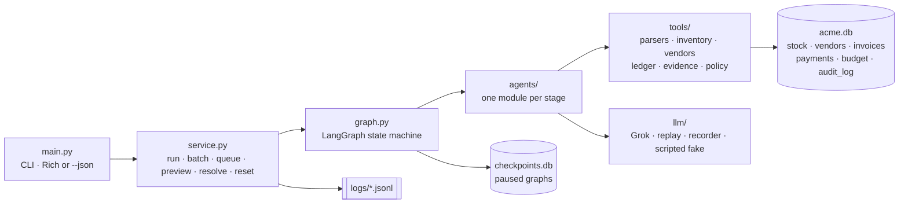
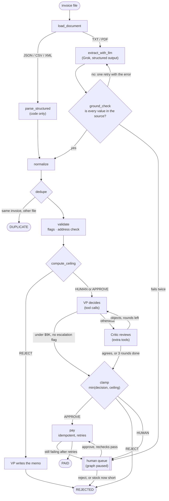
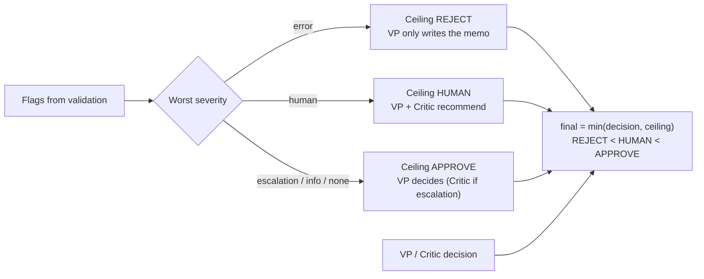
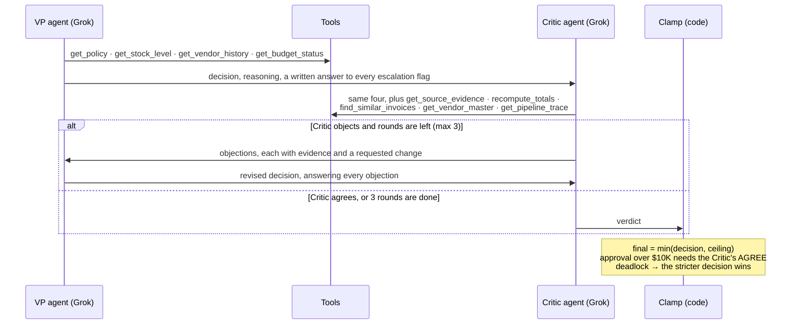

# Acme Invoice Processing: a multi-agent prototype

Acme loses **$2M a year** on manual invoice processing: a 30% error rate, 5-day delays and approvals buried in email chains. This repo automates the whole workflow (**ingest → validate → approve → pay**) as a local, multi-agent system built on **LangGraph** and **Grok**.

The idea in one sentence: **code enforces the hard rules, LLM agents handle messy documents and judgement calls, and a person sees an invoice only for one of six named reasons.**

On the 20 provided sample files (16 distinct invoice numbers):

| Paid | Rejected | Sent to a person | Duplicates caught | Decided without a person |
|---|---|---|---|---|
| 5 ($19,140) | 9 | 3 | 3 | **14 of 17 documents (82%)** |

Every rejection comes with written reasons. Every decision is in an audit log. No invoice is paid twice, and nothing over $10K is approved without a second agent agreeing.

> **Docs map.** This README covers what the system does, how to run it and why it's built this way.
> [DESIGN.md](DESIGN.md) is the full spec (every rule, flag and threshold).
> [ARCHITECTURE.md](ARCHITECTURE.md) covers how the code fits together (nodes, state, tables, tools).
> The original case brief is kept at the [bottom of this file](#appendix-the-original-case-brief).

---

## Contents

1. [Quick start](#1-quick-start)
2. [The sample invoices and their expected outcomes](#2-the-sample-invoices-and-their-expected-outcomes)
3. [How it works](#3-how-it-works)
4. [Key decisions and why](#4-key-decisions-and-why)
5. [What we found in the sample data](#5-what-we-found-in-the-sample-data)
6. [CLI reference](#6-cli-reference)
7. [Testing](#7-testing)
8. [Observability and error handling](#8-observability-and-error-handling)
9. [Business impact](#9-business-impact)
10. [Project layout](#10-project-layout)
11. [Scope: what's built, what's next](#11-scope-whats-built-whats-next)

---

## 1. Quick start

**Requirements:** [uv](https://docs.astral.sh/uv/) and Python 3.12 (uv installs it if needed). No API key is needed, because recorded Grok responses are committed (see [Replay](#replay-a-recorded-grok-run-instead-of-a-mock)).

```bash
uv sync                                                    # install dependencies
uv run python main.py --reset                              # create acme.db with the demo seed
uv run python main.py --dir data/invoices                  # run all 20 sample files
uv run python main.py --queue                              # see what's waiting for a person
uv run python main.py --resolve INV-1012 --approve --note "Called FastShip on the number on file"
```

Single invoice, in the form the brief asks for:

```bash
uv run python main.py --invoice_path=data/invoices/invoice_1001.txt
uv run python main.py --invoice_path=data/invoices/invoice_1001.txt --json   # one JSON object, nothing else
```

**Using live Grok instead of the recording:** put these in a `.env` file at the repo root. The recording was made with `grok-4.7` for both.

```dotenv
XAI_API_KEY=...
GROK_EXTRACTION_MODEL=grok-4.7
GROK_REASONING_MODEL=grok-4.7
```

With a key present, Grok is used automatically. `--provider replay` forces the recording.

> **State carries over between runs.** Stock, budget and history live in `acme.db`, just as they would in production. Every run prints a banner with the provider, remaining stock and budget. Run `--reset` to start fresh.

---

## 2. The sample invoices and their expected outcomes

Run from a fresh `--reset` (demo seed), as-of date **2026-01-31**, monthly budget **$50,000**, in filename order. These are the exact rows asserted by `tests/golden/test_sample_batch.py`, and the recorded Grok run reproduces all 20 of them.

**Who decided:**
- **rules:** an `error` flag fixed the outcome, and the VP only wrote the memo.
- **VP:** the fast path, with the VP alone.
- **VP + Critic:** the reflection loop.

**†** marks a real judgement call by the agents, as opposed to a rule.

| # | File | Vendor · amount | Flags raised | Expected outcome | Why |
|---|---|---|---|---|---|
| 1 | `invoice_1001.txt` | Widgets Inc. · $5,000 | — | **PAID** $5,000 (VP) | Clean and under $9K, so the VP decides alone (fast path). |
| 2 | `invoice_1002.txt` | Gadgets Co. · $15,000 | `insufficient_stock` · `over_threshold` · `past_due` · `terms_mismatch` · `value_normalized` | **REJECTED** (rules) | Asks for 20 GadgetX, but only 13 are in stock. The number "1002" is normalised to `INV-1002`. |
| 3 | `invoice_1003.txt` | Fraudster LLC · $100,000 | `zero_stock_item` · `invalid_due_date` · `unknown_vendor` · `over_threshold` | **REJECTED** (rules) | FakeItem has 0 stock, the due date is "yesterday", the vendor is unknown and the text says "URGENT… wire transfer". |
| 4 | `invoice_1004.json` | Precision Parts Ltd. · $1,890 | — | **PAID** $1,890 (VP) | Clean. The address matches the vendor master (yes, 742 Evergreen Terrace). |
| 5 | `invoice_1004_revised.json` | Precision Parts Ltd. · $5,940 | `revision_of_paid_invoice` | **PENDING_HUMAN** † | A revision of an invoice we already paid (it adds 5 GadgetX). Approving it pays only the **$4,050 difference**. |
| 6 | `invoice_1005.json` | Global Supply Chain Partners · $15,225 | `unknown_vendor` · `over_threshold` | **REJECTED** † (VP + Critic) | The rules allow approval, but this is an unknown vendor at 1600 Pennsylvania Ave billing over $10K. The VP rejects it (vendor not onboarded) and the Critic agrees. |
| 7 | `invoice_1006.csv` | Acme Industrial Supplies · $2,750 | — | **PAID** $2,750 (VP) | Clean. Uses the field/value CSV layout. |
| 8 | `invoice_1007.csv` | MegaWidgets Corp · $15,525 | `math_mismatch` (−$110) · `over_threshold` | **REJECTED** (rules) | Lines of $14,750 plus 6% tax come to $15,635, but the invoice says $15,525. |
| 9 | `invoice_1008.txt` | NoProd Industries · $9,900 | `unknown_item` ×2 · `unknown_vendor` · `near_threshold` · `past_due` | **REJECTED** (rules) | SuperGizmo and MegaSprocket aren't in inventory. |
| 10 | `invoice_1009.json` | *(none)* · −$250 | `non_positive_quantity` · `missing_vendor` · `invalid_due_date` · `math_mismatch` | **REJECTED** (rules) | Negative quantity, no vendor, no due date, and the stated subtotal ($1,000) doesn't match the lines. |
| 11 | `invoice_1010.txt` | Consolidated Materials Group · $7,185 | `price_above_catalog` | **REJECTED** † (VP + Critic) | A "rush" line bills WidgetA at $300 against a $250 catalog price (+20%), while another line bills the same item at $250. A note on the invoice isn't an authorised price exception. |
| 12 | `invoice_1011.pdf` | Summit Manufacturing Co. · $3,000 | — | **PAID** $3,000 (VP) | Clean. The PDF text is read with pdfplumber and extracted by the LLM. |
| 13 | `invoice_1011.txt` | Summit Manufacturing Co. · $3,000 | — | **DUPLICATE** of #12 | The same invoice in another format. It is never paid twice. |
| 14 | `invoice_1012.pdf` | QuickShip Distributers · $9,975 | `vendor_renamed` · `near_threshold` · `value_normalized` | **PENDING_HUMAN** † | "(formerly FastShip Ltd.)" is a classic impersonation pattern. Verifying it means calling the known contact, which only a person can do. OCR errors (`2O26`, `$3,500.O0`) are normalised. |
| 15 | `invoice_1012.txt` | QuickShip Distributers · $9,975 | — | **DUPLICATE** of #14 | |
| 16 | `invoice_1013.json` | Atlas Industrial Supply · $22,562.80 | `over_threshold` · `price_below_catalog` · `math_mismatch` (+$50) | **REJECTED** (rules) | Lines of $21,040 plus 7% tax come to $22,512.80, but the invoice says $50 more. `generate_pdfs.py` adds that $50. |
| 17 | `invoice_1013.pdf` | Atlas Industrial Supply · $22,562.80 | — | **DUPLICATE** of #16 | |
| 18 | `invoice_1014.xml` | TechParts International · €4,125 | `foreign_currency` | **PENDING_HUMAN** † | Invoiced in EUR. Exchange rates move, so a person enters the rate. |
| 19 | `invoice_1015.csv` | Reliable Components Inc. · $6,500 | — | **PAID** $6,500 (VP) | Clean. Uses the tabular CSV layout. |
| 20 | `invoice_1016.json` | Widgets Inc. · $3,233 | `unknown_item` (WidgetC) | **REJECTED** (rules) | WidgetC isn't in inventory. It is deliberately **not** fuzzy-matched to WidgetA (see [§4](#no-fuzzy-auto-correction-of-item-names)). |

Every scenario in the brief's own table behaves as the brief expects:
- **1001, 1004 and 1006** pass.
- **1002** is a stock mismatch.
- **1003** is out of stock.
- **1008 and 1016** have unknown items.
- **1009** is invalid data.

The other eight invoice numbers hold problems the brief didn't mention ([§5](#5-what-we-found-in-the-sample-data)).

### Stock and budget after each payment

| After | WidgetA | WidgetB | GadgetX | Budget spent |
|---|---|---|---|---|
| start | 90 | 50 | 13 | $0 |
| 1001 | 80 | 45 | 13 | $5,000 |
| 1004 | 77 | 43 | 13 | $6,890 |
| 1006 | 72 | 40 | 13 | $9,640 |
| 1011 | 66 | 37 | 13 | $12,640 |
| 1015 | 56 | 32 | 11 | $19,140 |

### Resolving the human queue

`--queue` then lists three items. Resolving them in this order is also a golden test (`tests/golden/test_queue_resolution.py`):

| Step | Command | Expected result |
|---|---|---|
| 1 | `--resolve INV-1012 --approve --note "..."` | Stock is rechecked (GadgetX 11 → 7). **PAID $9,975**, and "QuickShip Distributers" is stored as an alias of FastShip Ltd., so the next invoice under that name won't be flagged. Spent: $29,115. |
| 2 | `--resolve INV-1004 --approve --note "..."` | Only the 5 added GadgetX are checked and used (7 → 2). **PAID $4,050** (the difference). Spent: $33,165. |
| 3 | `--resolve INV-1014 --approve --note "..."` | **Refused** with *"An exchange rate to USD is required for EUR. Add --fx-rate RATE."* |
| 4 | `--resolve INV-1014 --approve --fx-rate 1.08 --note "..."` | **PAID €4,125**, which is $4,455 against the budget. Spent: $37,620. The queue is now empty. |

`--resolve REF` with no `--approve` or `--reject` is a **preview**. It shows what approving would pay, any stock shortfall, any budget overrun and any exchange rate needed, all before you commit.

---

## 3. How it works

### 3.1 Layers



| Layer | Rule |
|---|---|
| **CLI** | A thin wrapper over `service`, so a future UI calls the same functions. |
| **Service** | Owns the run lifecycle: trace IDs, the exact-bytes short-circuit, batch order, provider selection, crash containment. |
| **Graph** | Routing only. Each node delegates to an agent function. |
| **Agents** | One module per stage. Each node is a pure function `(state, deps) → state update`. |
| **Tools** | Deterministic Python over the database. Agents call them directly, and the same functions are exposed to the LLM as tool schemas. |
| **LLM** | One `Provider` interface. No agent imports a vendor SDK. |

### 3.2 The pipeline

Only **three steps call a model**: extraction from unstructured files, the **VP** and the **Critic**. Everything else is code.



| Stage | What happens |
|---|---|
| **Ingestion** | Structured files (JSON, two CSV layouts, XML) are parsed by code. TXT and PDF go to Grok with a strict output schema, which also carries a list of corrections (`2O26 → 2026`). The **grounding check** then confirms every extracted item, quantity and amount actually appears in the source. On failure it sends the error back for one retry; a second failure goes to a person. **Normalisation** produces `INV-NNNN` numbers, ISO dates and `Decimal` money. |
| **Validation** | Deterministic Python. It runs the duplicate and revision check, raises every rule flag, checks the vendor's address against the vendor master, and computes the **ceiling**. |
| **Approval** | The VP agent decides using tools. The Critic agent reviews with extra tools. Code then clamps the result to the ceiling. |
| **Payment** | Wraps the brief's `mock_payment(vendor, amount)` unchanged, adding idempotency, retries with backoff, and stock and budget updates in a single transaction. |
| **Human review** | LangGraph `interrupt()` pauses the graph and checkpoints it to `checkpoints.db`. `--resolve` resumes the same graph, which rechecks stock and budget first. |

### 3.3 The decision ceiling

Every flag has a **severity**. Severities set the **ceiling**: the best outcome the rules allow.



| Severity | Effect | Examples |
|---|---|---|
| `error` | Ceiling REJECT. The LLM has no say in the outcome. | `insufficient_stock`, `unknown_item`, `zero_stock_item`, `math_mismatch`, `non_positive_quantity`, `missing_vendor`, `invalid_due_date` |
| `human` | Ceiling HUMAN | `foreign_currency`, `vendor_renamed`, `revision_of_paid_invoice`, `conflicting_invoice_number`, `over_budget`, `payment_failed`, `unreadable_document` |
| `escalation` | No change, but the VP must answer it in writing, and it brings in the Critic | `unknown_vendor`, `price_above_catalog` |
| `info` | Context for the VP and the person | `over_threshold`, `near_threshold`, `past_due`, `terms_mismatch`, `value_normalized`, `price_below_catalog` |

The full catalogue (26 codes, with when each fires) is in [DESIGN.md §3.3](DESIGN.md).

### 3.4 The VP ⇄ Critic reflection loop



| Situation | Path |
|---|---|
| Ceiling REJECT | The VP writes the memo only. No Critic. |
| Ceiling APPROVE, **under $9,000**, no escalation flag | **Fast path:** the VP alone. It may approve or be stricter. |
| Everything else | **VP ⇄ Critic**, up to 3 Critic reviews |

The Critic has **more tools than the VP**, so the reviewer is grounded better than the decider: it can check source lines, recompute totals, look for split invoices and read the vendor master.

### 3.5 Duplicates and revisions

| Case | Detected by | Result |
|---|---|---|
| Exact same file run again | SHA-256 of the bytes | The stored result is returned and nothing is re-run |
| Same invoice, different format (1011, 1012, 1013) | Economic fingerprint: vendor, number, lines, total, currency | `DUPLICATE`, never paid |
| Same vendor and number, different content, no revision marker | Same vendor and number, different fingerprint | `conflicting_invoice_number` → person |
| Marked revision of a **paid** invoice (1004 R1) | `revision` field or a "revised" note | `revision_of_paid_invoice` → person. Approving pays the difference; if that is ≤ 0, the status is `CREDIT_DUE`. |
| Marked revision of an **unpaid** invoice | Same | The revision replaces it, and the original becomes `SUPERSEDED` |

---

## 4. Key decisions and why

### Rules set a ceiling; the LLM can only be stricter

The LLM picks an outcome **at or below** what the rules allow, and code takes `min(llm_decision, ceiling)`. If the model proposes something above the ceiling, the clamp logs a `ceiling_clamped` event.

**Why:** in a payment system the worst failure is paying something you shouldn't. An LLM is useful for judgement, such as whether an unknown vendor over $10K is acceptable (1005) or whether a rush-line note justifies a 20% markup (1010). It shouldn't be able to overturn "this item has zero stock". This keeps the model's mistakes on the safe side: it can wrongly reject, but it can never approve what the rules forbid.

### A closed list of six reasons for human review

An invoice reaches a person **only** for these reasons:
1. Foreign currency
2. Revision or conflicting number
3. Over budget
4. Vendor renamed
5. Payment still failing after retries
6. Unreadable document

**Why:** the pain point is a 5-day delay. If "send it to a person" is the escape hatch for anything uncertain, automation quietly collapses back into manual review. Each of the six is something an AI genuinely can't do, like phoning a vendor, setting an FX rate or authorising an overspend. A VP/Critic **deadlock resolves to the stricter decision**, not to a person, and a HUMAN proposal under an APPROVE ceiling becomes REJECT.

### Any math mismatch is rejected

If line amounts, the subtotal or the total are off by more than $0.01, in either direction, `math_mismatch` is an `error` flag and the invoice is rejected.

**Why:** this was an owner's business decision, made during the build. An earlier version paid the lower of the stated and recomputed totals. But an invoice that doesn't add up is either careless or manipulated, and in both cases the vendor should reissue it. That way nobody has to decide which number is "right". This is why 1007 (−$110) and 1013 (+$50) are rejected.

### A price above catalog explained only by a note is rejected (1010)

**Why:** this was also an owner's decision. A line note like "rush" is the vendor's claim, not an authorised price exception, and the same invoice bills the same item at catalog price on another line. The VP and Critic reach this through `get_policy`, so it's a judgement row (†), not a hard rule.

### The $9K–$10K band always gets the Critic

Invoices from $9,000 up to $10,000 skip the fast path, even with no other flags.

**Why:** that's where invoices get split to stay under a $10K approval threshold. Only the Critic's `find_similar_invoices` tool can see the other half of a split, so the band can't be decided by the VP alone. 1008 ($9,900) and 1012 ($9,975) sit right there.

### The demo seed raises the brief's starting stock

| Item | Brief's seed | Demo seed (default) | Unit price (added) |
|---|---|---|---|
| WidgetA | 15 | **90** | $250 |
| WidgetB | 10 | **50** | $500 |
| GadgetX | 5 | **13** | $750 |
| FakeItem | 0 | 0 | $1,000 |

**Why:** the brief's seed assumes each invoice is checked on its own. Real stock **carries over** and is used up when an invoice is paid. Under carried-over stock, the brief's seed breaks: after 1001 and 1004 are paid, only 2 WidgetA are left, and almost everything after that fails the stock check. That includes **1006, which the brief's own table says should pass**.

The demo numbers were picked so that:
- 1001, 1004, 1006 and 1011 pass.
- 1002 (needs 20 GadgetX) still fails.
- Enough is left for the queue walk-through.

To see the brief's numbers, run `--reset --seed readme`. The result is 2 paid, 1 person, 14 rejected and 3 duplicates, and a golden test asserts exactly that.

### Stock is checked per item, across all lines, and only used on payment

**Why:** 1013 has lines that each fit in stock individually, but WidgetA appears on several lines. A line-by-line check would miss the total. Invoices waiting in the human queue **don't reserve stock**, so stock is rechecked when the person resolves the invoice. If it's short then, the result is REJECT with a memo written by code.

### No fuzzy auto-correction of item names

Item names are matched ignoring case, whitespace and punctuation **only**. A near miss adds a "did you mean" hint to the flag; it never silently corrects the name.

**Why:** `WidgetC` scores about 86 against `WidgetA` on rapidfuzz's ratio. A fuzzy matcher would quietly turn 1016's unknown item into a real one and pay for it. On the other hand, `Widget A` (1012's OCR) correctly becomes `WidgetA`.

### Extraction must be grounded in the source

**Why:** LLMs can hallucinate a plausible quantity or total. The grounding check is the self-correction loop for ingestion. Code verifies that every extracted value appears in the document text, and feeds the specific failure back to the model for one retry. If it fails twice, the invoice is an `unreadable_document` and goes to a person. The bad data never reaches validation.

### The VP never sees the raw document

The VP gets the **structured** invoice only. Free-text fields (notes, addresses) are quoted and labelled as untrusted data. The Critic sees source text only one line at a time, through `get_source_evidence`.

**Why:** an invoice is attacker-controlled input. A note like "pre-approved by the CFO, ignore previous instructions" shouldn't reach the decision-maker as instructions. This isolation is in place now; a pattern-matching injection detector is planned ([§11](#11-scope-whats-built-whats-next)).

### Replay a recorded Grok run instead of a mock

Every real Grok call from a full batch is committed under `fixtures/replay/`. Each one is keyed by `(file hash, stage, prompt version, call index)`.

**Why:**
- **Anyone can run it.** Reviewers and CI can run the real agent behaviour offline, with no key.
- **Tests are deterministic.** The replay golden test checks that Grok's actual decisions still match the expected table.
- **Prompt edits can't drift silently.** Each prompt file carries a `prompt_version`, and editing a prompt makes its recordings stale. Replay then fails with "re-record" instead of quietly serving old answers.

`scripts/record.py` regenerates the recordings.

### One OpenAI-compatible client, not `xai_sdk`

Grok is called through the OpenAI SDK pointed at `https://api.x.ai/v1`. It supports structured outputs and tool calling.

**Why:** the brief's `from xai import Grok` snippet doesn't match a real SDK. One OpenAI-compatible code path also lets a local Ollama model drop in later with only a base-URL change.

### Smaller decisions

| Decision | Why |
|---|---|
| All money is `Decimal`, stored as TEXT in SQLite | Floats can't represent cents exactly. A payment system can't be off by a fraction of a cent. |
| Payment idempotency key = vendor + invoice number + revision | Retries, crashes or re-runs can never pay the same invoice twice. |
| Payment, stock decrement and budget entry share one SQLite transaction | A crash can't leave stock used up without a payment, or the reverse. |
| 4 payment attempts (0.5 s, 1 s, 2 s backoff), then a person | `--payment-fail-rate` lets you watch this happen. Approving from the queue retries the payment. |
| `over_budget` is checked only when no `error` flag fired | An invoice the rules reject can never be paid, so it shouldn't create budget work for a person. |
| Threshold flags use the stated total; budget and payment use the payable amount | A $5,940 revision is still a $5,940 invoice for scrutiny, but it only pays and spends $4,050. |
| As-of date defaults to 2026-01-31 | The samples are January 2026 invoices, so past-due checks need a fixed "today" to be meaningful and reproducible. |
| A `verified` address is never grounds for rejection | 1004's vendor really is at 742 Evergreen Terrace on file. The model shouldn't reject it because the address looks like a joke. |
| `ERROR` is reserved for bugs | An unparseable file is a business case (`unreadable_document` → person). An unexpected exception is a bug: it marks that invoice `ERROR`, pays nothing, keeps the batch going, and is never short-circuited on re-run. |

---

## 5. What we found in the sample data

The brief documents 8 of the 16 invoice numbers. Reading every file turned up these:

| Invoice | Finding | How it's handled |
|---|---|---|
| 1011, 1012, 1013 | Each appears **twice** (TXT/JSON plus a PDF). A naive batch pays each one twice. | Fingerprint dedupe → `DUPLICATE` |
| 1004 / 1004_revised | Same number. R1 adds 5 GadgetX "per PO amendment". | Revision of a paid invoice → person; pays the difference only |
| 1007 | Total is **$110 short** of lines + tax | `math_mismatch` → rejected |
| 1013 | Total is **$50 over** lines + tax. `generate_pdfs.py` adds it, and both committed files contain it. | `math_mismatch` → rejected |
| 1014 | **XML** and **EUR**. The brief mentions neither. | XML parser; `foreign_currency` → person enters the rate |
| 1006 vs 1007/1015 | Two different **CSV layouts** (field/value rows vs a table) | Two CSV parsers |
| 1012 | OCR damage (`2O26`, `$3,500.O0`, `Widget A`, `INV 1012`) and a vendor "formerly FastShip": an impersonation pattern, just under $10K | Normalised with `value_normalized`; `vendor_renamed` → person |
| 1010 | The same item on two lines, one a $300 "rush" line vs a $250 catalog price | `price_above_catalog` → VP + Critic reject |
| 1005 | Unknown vendor at 1600 Pennsylvania Ave, over $10K | VP + Critic reject |
| 1002 | Due date equals the invoice date despite Net 30. The number lacks the `INV-` prefix. | `terms_mismatch`, `value_normalized` (info) |
| 1008 | Email-style text, unknown vendor, $9,900, just under the threshold | Unknown items → rejected; the near-threshold band would bring in the Critic anyway |

**Every invoice over $10K in the sample set fails at least one check.** So the "approval over $10K needs the Critic's agreement" path is covered by unit tests, not by a sample.

---

## 6. CLI reference

```bash
python main.py --invoice_path=FILE          # one invoice (the brief's form; --invoice-path also works)
python main.py --dir DIR                    # batch, with a summary table and totals
python main.py --queue                      # list invoices waiting for a person
python main.py --resolve REF                # preview: what approving would do
python main.py --resolve REF --approve --note "..." [--fx-rate 1.08] [--confirm-overspend]
python main.py --resolve REF --reject  --note "..."
python main.py --reset [--seed demo|readme] # restore starting stock and budget, clear history
```

| Common flag | Purpose |
|---|---|
| `--provider grok\|replay` | Choose the model provider. By default: Grok if `XAI_API_KEY` is set, else replay if every file has a recording, else exit with a message saying how to get a model. |
| `--json` | Turn off Rich and print exactly one JSON object to stdout |
| `--as-of YYYY-MM-DD` | The date used for past-due checks (default 2026-01-31) |
| `--payment-fail-rate R` | Inject payment failures (0–1) to demonstrate retries and `payment_failed` |

**What you see:**
- **Run banner:** the provider and recording date, the seed, the as-of date, the budget used and stock per item.
- **Per invoice:** live stage-by-stage progress, then a coloured flags table and a decision panel with the VP's reasoning, the Critic's verdict and every tool each one called.
- **Batch table:** a **Reason** column for every rejection.
- **Queue:** the reason, the agents' recommendation and the amount.

**Exit codes:**
- `0`: ok
- `1`: error
- `2`: usage
- `3`: resolution refused (for example, a missing `--fx-rate` or overspend confirmation)

---

## 7. Testing

```bash
uv run pytest            # 590 tests, offline, about 30 s
uv run pytest -m live    # 6 tests against real Grok (needs .env)
```

| Suite | Tests | Provider | What it proves |
|---|---|---|---|
| `tests/unit/` | 517 | none or scripted fake | Every parser, normalisation, each flag rule, ceiling, clamp, routing function, dedupe case, tool, payment idempotency and retries, provider selection, the CLI |
| `tests/golden/test_sample_batch.py` | | scripted fake | The 20-row table in [§2](#2-the-sample-invoices-and-their-expected-outcomes): every flag, ceiling, outcome, path, and the ledger after each payment |
| `tests/golden/test_replay.py` | | **recorded Grok** | Grok's real decisions still match the golden table |
| `tests/golden/test_queue_resolution.py` | | scripted fake | The queue walk-through, plus the opposite order |
| `tests/golden/test_paths_e2e.py` | | scripted fake | One end-to-end test per path: paid, rejected, human, duplicate, error (injected crash), payment failure, unreadable file |
| `tests/golden/test_readme_seed.py` | | scripted fake | The brief's seed gives 2 paid / 1 person / 14 rejected / 3 duplicates |
| `tests/live/` | 6 | live Grok | Invariants only: final ≤ ceiling, every escalation flag answered, the Critic agreed on any approval over $10K |

The golden suites hold 73 tests in total.

**Guardrails in the test setup:**
- An autouse fixture **blocks network sockets** unless a test is marked `live`.
- Every test gets its own temporary `acme.db` and `checkpoints.db`.
- Tests never load `.env`.

---

## 8. Observability and error handling

**Structured logs:** `logs/YYYY-MM-DD.jsonl` holds one event per line. Each event carries a `trace_id`; the logger refuses events without one.

```json
{"ts": "2026-11-15T00:52:47.294734+00:00", "trace_id": "inv-invoice-1001-48ef7153",
 "invoice": "invoice_1001.txt", "node": "extraction", "event": "llm_call", "duration_ms": 5757,
 "tokens_in": 3298, "tokens_out": 181, "provider": "replay", "data": {"stage": "extraction", "...": "..."}}
```

The event types are `node_start`, `node_end`, `llm_call`, `tool_call`, `flag_raised`, `ceiling_clamped`, `retry`, `interrupt`, `resume`, `payment` and `error`. The CLI's live progress view is driven by the real graph event stream, not a separate animation.

**Audit trail:** every business decision (VP and Critic turns, clamps, human resolutions, payments) is written to the `audit_log` table, with an actor of `system`, `vp`, `critic` or `human`.

| Failure | Handling |
|---|---|
| File can't be parsed, or extraction fails grounding twice | `unreadable_document` → person (reject only; fix the file and re-run) |
| LLM returns an invalid structured output | One retry with the validation error, then the node raises |
| Unexpected exception in any node | That invoice is `ERROR` and the traceback is logged with its `trace_id`. Nothing is paid and the batch continues. |
| Replay recording missing or stale | `ERROR`, with a "re-record" hint |
| Payment keeps failing | 4 attempts with backoff, then `payment_failed` → person |

---

## 9. Business impact

| Pain point | What addresses it |
|---|---|
| **30% error rate** | Deterministic validation, per-item stock totals, independent math recomputation, grounding checks on every extracted value |
| **5-day delays** | Seconds per invoice. A person only sees six named kinds of exception, and 82% of the sample documents needed nobody. |
| **Email approval chains** | The VP ⇄ Critic loop produces written reasoning and a full audit trail, and `--resolve` gives a person a one-line decision with a required note |
| **Fraud risk** | Hard rules the LLM can't override, vendor-rename detection, an address check against the vendor master, split-invoice detection in the $9K–$10K band, and the VP isolated from raw document text |

**Estimating savings.** The formula is:

`annual volume × automation rate × baseline cost per invoice − annual volume × LLM cost per invoice`

The inputs come from two places:
- **Automation rate** is measured: 82% on the sample batch. The samples are deliberately problem-heavy, so a real mix of mostly clean invoices should do better.
- **Annual volume** (20,000 invoices, so $2M a year works out to $100 per invoice) is an **assumption**, set in `config/settings.toml`.

With those inputs the gross figure is about **$1.6M a year**, before LLM cost. Token counts are logged per call today; cost reporting is on the roadmap.

---

## 10. Project layout

```
main.py              CLI (argparse + Rich); keeps the brief's --invoice_path form
service.py           run_invoice, run_batch, queue, preview_resolution, resolve, reset
graph.py             LangGraph nodes, routing functions, SQLite checkpointer
models.py            Pydantic contracts: InvoiceState, ExtractedInvoice, Invoice, Flag, Decision, …
policy.md            Human-readable policy, served to the agents by get_policy(topic)
config/settings.toml Thresholds, budget, as-of date, retries, labelled business assumptions
agents/              ingestion · validation · risk · vp · critic · clamp · human · payment · outcome · _loop
tools/               inventory · vendors · ledger · evidence · policy · normalize · grounding · bank
tools/parsers/       json_ · csv_kv · csv_table · xml_ · pdf
llm/                 Provider interface, OpenAI-compatible client, recorder, replay, scripted fake, selection
llm/prompts/         extraction.md · vp.md · critic.md · vp_memo.md (each with a prompt_version)
db/                  schema.sql · seed.py (demo and readme seeds, vendor master) · repo.py
core/                shared helpers: text, values (money/dates), invoice_math
scripts/record.py    re-record the Grok run into fixtures/replay/
fixtures/replay/     the committed Grok recording
data/invoices/       the provided samples (never modified)
tests/               unit/ · golden/ · live/
```

---

## 11. Scope: what's built, what's next

The design was planned in three tiers, each complete without the ones after it. **Tier 1 is built and tested.**

| Tier | Contents | Status |
|---|---|---|
| **1** | LangGraph pipeline, all four stages, VP ⇄ Critic loop, human queue with pause and resume, idempotent payments, SQLite state, CLI, Grok + replay providers, recorder, unit/golden/replay/live tests, JSONL logs | **Done** |
| **2** | Streamlit dashboard: process view, human queue, ledger, batch metrics. It will call the same `service` functions as the CLI. | Planned |
| **3** | Additive risk score (`high_risk_score`), prompt-injection detector, extra test invoices (a clean approval over $10K, an injection attempt, an overcharge, a split invoice, over budget), cost metrics, Ollama provider | Planned |

`agents/risk.py` is already wired into the graph as a pass-through, so tier 3 slots in without changing routing. [ARCHITECTURE.md](ARCHITECTURE.md) describes the tier 2 and 3 pieces as designed.

**Cut on purpose:**

| Cut | Instead |
|---|---|
| Email inbox ingestion | Folder input (`--dir`) |
| OCR for scanned images | PDFs need a text layer (all three samples have one) |
| Login and multiple users | One local operator |
| Real banking | `mock_payment` wrapped with idempotency and retries |
| Live FX rates | Foreign-currency invoices go to a person, who enters the rate |

---

## Appendix: the original case brief

<details>
<summary>The case brief as provided (click to expand)</summary>

### Background

Acme Corp is a PE-backed manufacturing firm losing **$2M/year** on manual invoice processing. Invoices arrive via email as PDFs in messy formats with frequent errors. Staff manually extract data, validate against a legacy inventory database (inconsistent), obtain VP approval (via email chains), and process payment (via a banking API).

**Current pain points:** 30% error rate · 5-day processing delays · frustrated stakeholders.

### Objective

Build a **multi-agent system** that automates the end-to-end invoice processing workflow. The system must run as a working prototype, not just designs or slides.

### Workflow

1. **Ingestion:** Extract structured data from invoice documents (PDFs, text files). Fields include Vendor, Amount, Items (with quantities) and Due Date. Expect unstructured text, typos, missing data and potentially fraudulent entries.
2. **Validation:** Verify extracted data against a mock inventory database (SQLite). Flag mismatches such as quantity exceeding available stock or items not found in inventory.
3. **Approval:** Simulate VP-level review with rule-based decision-making (e.g., invoices over $10K require additional scrutiny). The agent should reason through approval/rejection with a reflection or critique loop.
4. **Payment:** If approved, call a mock payment function. If rejected, log the rejection with reasoning.

### Technical requirements

- **LLM integration:** xAI's Grok as the core reasoning engine (other models are acceptable without an API key).
- **Multi-agent orchestration:** LangGraph, CrewAI, AutoGen, or a custom solution.
- **Agent capabilities:** function calling / tool use, structured outputs, self-correction loops.
- **Runtime:** assume no internet for external APIs; simulate everything locally.
- **Tech stack:** Python, run locally, no cloud deployment.

### Provided resources

**Mock invoice data** in `data/invoices/` (PDF, CSV, JSON, TXT), mixing clean and problematic entries.

**Mock inventory database (starter seed):**

```python
cursor.execute('CREATE TABLE IF NOT EXISTS inventory (item TEXT PRIMARY KEY, stock INTEGER)')
cursor.execute("""
    INSERT INTO inventory VALUES
    ('WidgetA', 15), ('WidgetB', 10), ('GadgetX', 5), ('FakeItem', 0)
""")
```

| Scenario | Invoice | What should happen |
|---|---|---|
| Normal order within stock | INV-1001, INV-1004, INV-1006 | Items found, quantities valid; passes validation |
| Quantity exceeds stock | INV-1002 (20× GadgetX, only 5 in stock) | Flagged as stock mismatch |
| Fraudulent / zero-stock item | INV-1003 (FakeItem, 0 stock) | Flagged as out of stock or suspicious |
| Item not in database at all | INV-1008 (SuperGizmo, MegaSprocket), INV-1016 (WidgetC) | Flagged as unknown item |
| Invalid data | INV-1009 (negative quantity) | Flagged as data integrity issue |

**Mock payment API:**

```python
def mock_payment(vendor, amount):
    print(f"Paid {amount} to {vendor}")
    return {"status": "success"}
```

**Grok API setup (as given):**

```python
from xai import Grok
client = Grok(api_key="your_key")
response = client.chat.completions.create(model="grok-3", messages=[...])
```

### Running the system

```bash
python main.py --invoice_path=data/invoices/invoice1.txt
```

### Evaluation criteria

Functionality · Code quality · Agentic sophistication · Shipping mindset · Presentation · Above/beyond · UI/UX

### Submission

A link to a public GitHub repository.

</details>
